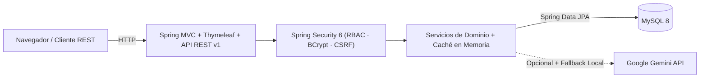

# Odyssey — Plataforma Web Turística Inteligente (Cartagena de Indias)

[](https://github.com/josezambranol/Odyssey/actions/workflows/ci.yml)


Plataforma web y API REST desarrollada en **Java 21 + Spring Boot 3** con arquitectura monolítica modular en capas, persistencia unificada en **MySQL 8**, caché en memoria de Spring, autenticación con **Spring Security 6**, internacionalización nativa **ES / EN**, documentación interactiva **OpenAPI/Swagger** y asistente turístico impulsado por **Google Gemini** con motor de respaldo local.

---

## Capacidades Principales

- **Acceso abierto + comunidad autenticada (RBAC):** Exploración libre del catálogo turístico, mapa interactivo, guía de transporte y cartelera cultural. El registro de usuarios (con aceptación explícita de Términos y Política de Privacidad Ley 1581) habilita reseñas verificadas, postulación de lugares, suscripciones y panel de administración (`/admin/**`).
- **Persistencia Unificada (MySQL 8 + Spring Data JPA):**
  - Catálogo turístico (`lugares` con coordenadas geográficas Haversine, `categorias`, `actividades`, `eventos`), `usuarios`, `resenas`, `itinerarios`, `reportes`, `suscripciones_lugares`, `codigos_verificacion` y `chatbot_logs`.
- **Caché en Memoria (Spring Cache):** Caché de catálogo y cartelera sin necesidad de servidores auxiliares.
- **API REST v1 + OpenAPI/Swagger:** Endpoints versionados (`/api/v1/lugares`, `/api/v1/eventos`, `/api/v1/itinerarios`, `/api/v1/reportes`, `/api/v1/metricas`) documentados en `/swagger-ui.html`.
- **Asistente Turístico Híbrido:** Integración con Google Gemini (`GEMINI_API_KEY`) y fallback determinístico local sobre base de datos MySQL.
- **Internacionalización nativa (ES / EN):** Cambio de idioma gestionado desde servidor con `SessionLocaleResolver` y archivos `i18n/messages*.properties` (sin scripts ni cookies de terceros).
- **Autenticación y Seguridad:** Contraseñas con **BCrypt**, protección **CSRF**, validación de entradas con Jakarta Validation, carga segura de archivos (`FileStorageService`), páginas legales (`/terminos`, `/privacidad`) y flujo de códigos **OTP por SMTP**.

---

## Arquitectura



---

## Stack Tecnológico

| Capa | Tecnologías |
| :--- | :--- |
| **Backend** | Java 21 LTS, Spring Boot 3.2.5, Spring Security 6, Spring Data JPA, Spring Cache |
| **API & Docs** | Spring MVC, Springdoc OpenAPI 3 / Swagger UI, Bean Validation |
| **Frontend** | Thymeleaf, Bootstrap 5, Leaflet (OpenStreetMap), HTML5, CSS3, JavaScript |
| **Base de datos** | MySQL 8.0 |
| **Testing & CI** | JUnit 5, Mockito, Spring Security Test, H2 (perfil `test`), GitHub Actions |
| **Contenedores** | Docker, Docker Compose (2 servicios: `odyssey_mysql` + `odyssey_backend`) |

---

## Ejecución Rápida

### Opción 1: Todo el stack con Docker Compose (Recomendado)

```bash
git clone https://github.com/josezambranol/Odyssey.git
cd Odyssey
cp .env.example .env
docker compose up -d --build
```

Servicios disponibles:
- **Aplicación Web:** `http://localhost:8080`
- **Swagger UI:** `http://localhost:8080/swagger-ui.html`
- **Términos y Privacidad:** `http://localhost:8080/terminos` · `http://localhost:8080/privacidad`

### Opción 2: Ejecución local con Maven

1. Configura `.env` (o variables de entorno) tomando como base `.env.example`.
2. Importa `sql/odyxsvg_db.sql` en tu servidor MySQL local si no usas Docker.
3. Ejecuta pruebas o levanta el servidor:

```bash
# Ejecutar suite completa de pruebas (perfil H2 en memoria, sin dependencias externas)
mvn test

# Iniciar aplicación
mvn spring-boot:run
```

---

## Pruebas Automatizadas

La suite incluye pruebas unitarias de servicios y controladores REST (JUnit 5 + Mockito) y pruebas de integración de flujo de autenticación (`MockMvc` + Spring Security Test) ejecutables de forma aislada mediante el perfil `test` con H2:

```bash
mvn -B test
```

---

## Registro de Errores, Pruebas y Fallas

Todas las incidencias detectadas en pruebas manuales (QA en navegador), fallos de compilación/ejecución, regresiones y resultados de la suite de pruebas se documentan de forma continua en:

- **[06. Bitácora de Errores, Pruebas y Fallas](./docs/06_REGISTRO_ERRORES_Y_PRUEBAS.md)**

| Última Verificación | Alcance | Resultado | Observaciones |
| :--- | :--- | :--- | :--- |
| `mvn -B clean package` (2026-11-20) | 34 tests (servicios, REST API v1, seguridad e integración H2) | **34/34 pasaron** (`0` fallos) | Validado tras Fases 1–7, auditoría de seguridad/rutas y optimización de rendimiento |
| QA Humano & Rendimiento PC / Móvil (2026-11-20) | `1440×900` (PC) y `390×844` (Móvil) sobre `/`, `/lugares`, `/mapa`, `/transporte`, `/eventos`, `/chatbot`, `/registro` | **15 bloques (`ERR-001`–`ERR-015`) corregidos** | Imágenes reducidas `-73.8%` (`19.30 MB → 5.06 MB`), GZIP + `Cache-Control` 30d activos y correcciones responsive en `/mapa` y controles móviles |

---

## Documentación Técnica Adicional

- [01. Contexto e Historias de Usuario](./docs/01_CONTEXTO_Y_HISTORIAS_DE_USUARIO.md)
- [02. Arquitectura y Modelo de Datos](./docs/02_ARQUITECTURA_Y_MODELO_DE_DATOS.md)
- [03. Diagnóstico de Seguridad y Deuda Técnica](./docs/03_SEGURIDAD_Y_DEUDA_TECNICA.md)
- [04. Hoja de Ruta y Plan de Modernización](./docs/04_HOJA_DE_RUTA_Y_PLAN_DE_REFACCION.md)
- [05. Plan de Fases y Reglas de Refactorización](./docs/05_PLAN_FASES_Y_REGLAS.md)
- [06. Registro de Errores, Pruebas y Fallas](./docs/06_REGISTRO_ERRORES_Y_PRUEBAS.md)

---

## Autor

**Jose Daniel Zambrano Luna** — [GitHub](https://github.com/josezambranol) · [LinkedIn](https://www.linkedin.com/in/josedanielluna)
