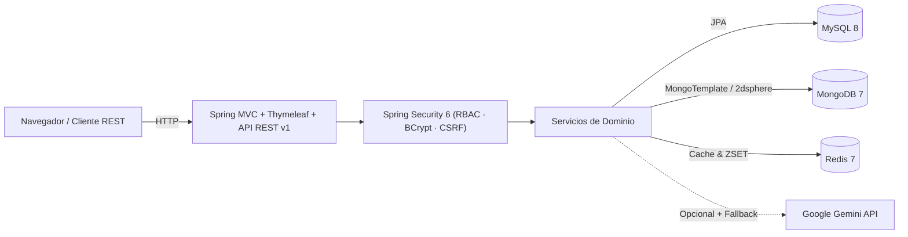

# Odyssey — Plataforma Web Turística Inteligente (Cartagena de Indias)

[](https://github.com/josezambranol/Odyssey/actions/workflows/ci.yml)


Plataforma web y API REST desarrollada en **Java 21 + Spring Boot 3** con arquitectura de persistencia políglota (**MySQL + MongoDB + Redis**), autenticación con **Spring Security 6**, documentación interactiva **OpenAPI/Swagger** y asistente turístico impulsado por **Google Gemini** con motor de respaldo local.

---

## Capacidades Principales

- **Acceso abierto + comunidad autenticada (RBAC):** Exploración libre del catálogo turístico, mapa interactivo, guía de transporte y cartelera cultural. El registro de usuarios habilita reseñas verificadas, postulación de lugares, suscripciones y panel de administración (`/admin/**`).
- **Persistencia políglota (MySQL + MongoDB + Redis):**
  - **MySQL 8 (Spring Data JPA):** Usuarios, categorías, lugares, actividades, eventos y reseñas con integridad relacional.
  - **MongoDB 7:** Telemetría, reportes agregados, itinerarios generados, logs de scraping/chatbot y consultas geoespaciales (`2dsphere`).
  - **Redis 7:** Caché de catálogo/métricas y rankings en tiempo real con fallback resiliente si Redis no está disponible.
- **API REST v1 + OpenAPI/Swagger:** Endpoints versionados (`/api/v1/lugares`, `/api/v1/eventos`, `/api/v1/itinerarios`, `/api/v1/reportes`, `/api/v1/metricas`) documentados en `/swagger-ui.html`.
- **Asistente Turístico Híbrido:** Integración con Google Gemini (`GEMINI_API_KEY`) y fallback determinístico sobre base de datos local cuando no hay clave o cuota disponible.
- **Autenticación y Seguridad:** Contraseñas con **BCrypt**, protección **CSRF**, validación de entradas con Jakarta Validation, carga segura de archivos (`FileStorageService` con validación de extensiones y bloqueo de path traversal) y flujo de códigos **OTP por SMTP**.

---

## Arquitectura



---

## Stack Tecnológico

| Capa | Tecnologías |
| :--- | :--- |
| **Backend** | Java 21 LTS, Spring Boot 3.2.5, Spring Security 6, Spring Data JPA, Spring Data MongoDB, Spring Data Redis |
| **API & Docs** | Spring MVC, Springdoc OpenAPI 3 / Swagger UI, Bean Validation |
| **Frontend** | Thymeleaf, Bootstrap 5, HTML5, CSS3, JavaScript |
| **Bases de datos** | MySQL 8.0, MongoDB 7.0, Redis 7.2 |
| **Testing & CI** | JUnit 5, Mockito, Spring Security Test, H2 (perfil `test`), GitHub Actions |
| **Contenedores** | Docker, Docker Compose |

---

## Ejecución Rápida

### Opción 1: Todo el stack con Docker Compose (Recomendado)

```bash
git clone https://github.com/josezambranol/Odyssey.git
cd Odyssey
cp .env.example .env
docker compose up -d --build
```

Servicios disponibles:
- **Aplicación Web:** `http://localhost:8080`
- **Swagger UI:** `http://localhost:8080/swagger-ui.html`
- **Mongo Express:** `http://localhost:8081`
- **Redis Commander:** `http://localhost:8082`

### Opción 2: Ejecución local con Maven

1. Configura `.env` (o variables de entorno) tomando como base `.env.example`.
2. Importa `sql/odyxsvg_db.sql` en tu servidor MySQL local si no usas Docker.
3. Ejecuta pruebas o levanta el servidor:

```bash
# Ejecutar suite completa de pruebas (perfil H2 en memoria, sin dependencias externas)
mvn test

# Iniciar aplicación
mvn spring-boot:run
```

---

## Pruebas Automatizadas

La suite incluye pruebas unitarias de servicios y controladores REST (JUnit 5 + Mockito) y pruebas de integración de flujo de autenticación (`MockMvc` + Spring Security Test) ejecutables de forma aislada mediante el perfil `test` con H2:

```bash
mvn -B test
```

---

## Documentación Técnica Adicional

- [01. Contexto e Historias de Usuario](./docs/01_CONTEXTO_Y_HISTORIAS_DE_USUARIO.md)
- [02. Arquitectura y Modelo de Datos](./docs/02_ARQUITECTURA_Y_MODELO_DE_DATOS.md)
- [03. Diagnóstico de Seguridad y Deuda Técnica](./docs/03_SEGURIDAD_Y_DEUDA_TECNICA.md)
- [04. Hoja de Ruta y Plan de Modernización](./docs/04_HOJA_DE_RUTA_Y_PLAN_DE_REFACCION.md)

---

## Autor

**Jose Daniel Zambrano Luna** — [GitHub](https://github.com/josezambranol) · [LinkedIn](https://www.linkedin.com/in/josedanielluna)
