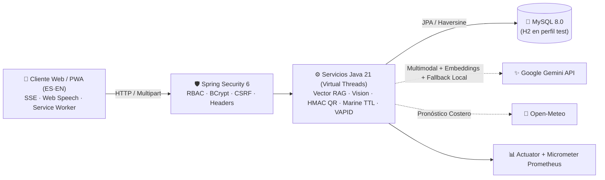

# ⛵ Odyssey `v5.0.0` — Smart Destination Platform (Cartagena de Indias)

[](https://github.com/josezambranol/Odyssey/actions/workflows/ci.yml)


Plataforma turística **PWA Offline-First** y **Smart Destination** para **Cartagena de Indias (Patrimonio UNESCO 1984)**, construida con **Java 21 (*Project Loom Virtual Threads*)** y **Spring Boot 3**. Combina streaming de IA en tiempo real (**SSE + Voz Bilingüe ES/EN**), búsqueda híbrida con **Embeddings Vectoriales**, **Visión Multimodal Anti-Sobrecobros**, **Pases QR firmados con `HMAC-SHA256`**, **Pronóstico Marino/UV**, **Web Push `VAPID P-256`** y **cumplimiento legal colombiano verificable**.

---

## 🌟 Capacidades de Ingeniería (`v1.0` → `v5.0`)

- **🧠 Búsqueda Híbrida SQL + Semántica Vectorial (`/buscar` & `/api/v1/lugares/semantico`):** Combina consultas relacionales con vectores densos normalizados $L_2$ (`256d` locales + integración con *Google Gemini `text-embedding-004` `768d`*) ordenados por similitud del coseno y porcentaje de afinidad.
- **📸 Escáner Multimodal IA & Escudo Anti-Sobrecobros (`/escaner` & `/api/v1/vision/analizar`):** Reconoce monumentos coloniales por fotografía y audita menús/cuentas en pesos (`COP`/`USD`) frente a precios justos de referencia en Cartagena conforme al **Art. 26 de la Ley 1480 de 2011**, procesando imágenes en RAM sin persistir fotos privadas en disco.
- **🎫 Pases Turísticos QR Antifraude (`/api/v1/pases/emitir` & `/verificar`):** Emisión y validación sin estado (*stateless*) en tiempo constante mediante firma criptográfica **`HMAC-SHA256`**, matriz QR vectorial SVG y verificación de formato **RNT (`Ley 2068 de 2020`)**.
- **⚡ Concierge IA en Tiempo Real con *Virtual Threads* (`SSE` + Voz):** Streaming progresivo de tokens (`GET /api/v1/ai/stream`) sobre hilos virtuales de Java 21 con medición *TTFT*, dictado por micrófono (*STT*) y lectura neuronal (*TTS*) en Español e Inglés.
- **⚓ Inteligencia Climática Marina & Cartografía Activa (`/mapa` & `/api/v1/clima/marino`):** Radar geoespacial **Haversine** en MySQL, trazado peatonal OSRM y rutas náuticas desde el Muelle de la Bodeguita con semáforo de zarpe (`VERDE`/`AMARILLO`/`ROJO`), nudos de viento, alerta UV y caché `Lock-Free TTL` de 15 minutos.
- **📲 PWA Offline-First + Notificaciones Web Push (`VAPID P-256`):** Instalable en Android, iOS y escritorio (`manifest.webmanifest`, `sw.js`), guía SOS sin conexión (`offline.html` con tarifas DATT y líneas de emergencia) y claves criptográficas de curva elíptica `secp256r1` nativas en Java 21.
- **⚖️ Blindaje Legal Colombiano Automatizado:** Cumplimiento de **Ley 1581 de 2012** y **Decreto 1377 de 2013** (prueba de consentimiento con timestamp, bloqueo `<18` años, IP seudonimizada `SHA-256`, autoservicio **ARCO** de portabilidad JSON y supresión total de cuenta en `/menu`) y cláusula turística **ESCNNA (`Ley 679 de 2001`)**.

---

## 🏗️ Arquitectura del Sistema



---

## 🔌 Principales Endpoints API REST v1 (`/swagger-ui.html`)

| Dominio | Método y Ruta | Descripción |
| :--- | :--- | :--- |
| **Streaming IA** | `GET /api/v1/ai/stream?q=...` | Respuesta generativa token a token vía *Server-Sent Events* (`TTFT`) |
| **Vector RAG** | `GET /api/v1/lugares/semantico?q=...` | Búsqueda por intención natural mediante similitud del coseno |
| **Geoespacial** | `GET /api/v1/lugares/cercanos?lat=...&lng=...` | Radar **Haversine** en MySQL por radio en kilómetros |
| **Clima Marino** | `GET /api/v1/clima/marino` | Semáforo náutico Islas del Rosario, viento (`kt`) e índice UV |
| **Visión & Precios** | `POST /api/v1/vision/analizar` | Reconocimiento fotográfico y auditoría anti-sobrecobros en RAM |
| **Pases QR HMAC** | `POST /api/v1/pases/emitir` · `GET /verificar` | Firma y verificación criptográfica `HMAC-SHA256` + control RNT |
| **Web Push PWA** | `GET /api/v1/push/vapid-public-key` · `POST /subscribe` | Registro W3C Push con clave pública EC `P-256` (65 bytes) |
| **Observabilidad** | `GET /actuator/health/liveness` · `/prometheus` | Sondas Cloud-Native y métricas para Prometheus/Grafana |

---

## 🚀 Ejecución Rápida

### Opción 1: Docker Compose (Todo el stack)
```bash
git clone https://github.com/josezambranol/Odyssey.git
cd Odyssey
cp .env.example .env
docker compose up -d --build
```

### Opción 2: Desarrollo local con JDK 21 + Maven
```bash
# Ejecutar las 48 pruebas automatizadas + reporte de cobertura JaCoCo (usa H2 en memoria, cero dependencias externas)
mvn -B test

# Levantar aplicación en http://localhost:8080
mvn spring-boot:run
```
> **Seguridad de secretos:** Para usar tu `GEMINI_API_KEY` en local sin exponerla jamás a Git, colócala en `src/main/resources/application-local.properties` (ignorado en `.gitignore` y protegido por guardia DevSecOps en GitHub Actions). En la nube (`render.yaml`), inyéctala como variable de entorno secreta.

---

## ✅ Calidad, Pruebas y Documentación de Ingeniería

| Suite de Verificación | Estado | Cobertura Funcional |
| :--- | :--- | :--- |
| `mvn -B test` + **JaCoCo** | **48 / 48 pruebas en verde** (`0` fallos, `0` warnings Thymeleaf) | Auth/OTP, RBAC, Haversine, SSE Virtual Threads, RAG Vectorial, Clima Marino, VAPID `P-256`, Ley 1581 ARCO/ESCNNA, Visión Anti-Sobrecobros y Pases QR `HMAC-SHA256` |
| **GitHub Actions CI** | Activo en cada `push` y `PR` | Guardia anti-fuga de API Keys + Suite JUnit 5/MockMvc + Reporte JaCoCo + Construcción `Dockerfile` multi-stage |

### Documentación del Repositorio
- [01. Contexto e Historias de Usuario](./docs/01_CONTEXTO_Y_HISTORIAS_DE_USUARIO.md)
- [02. Arquitectura y Modelo de Datos](./docs/02_ARQUITECTURA_Y_MODELO_DE_DATOS.md)
- [03. Diagnóstico de Seguridad y Deuda Técnica](./docs/03_SEGURIDAD_Y_DEUDA_TECNICA.md)
- [04. Hoja de Ruta Oficial (5 Macro-Versiones Completadas)](./docs/04_HOJA_DE_RUTA_Y_PLAN_DE_REFACCION.md)
- [06. Bitácora de Errores, Pruebas y QA](./docs/06_REGISTRO_ERRORES_Y_PRUEBAS.md)

---

## 👨‍💻 Autor y Licencia

Desarrollado por **Jose Daniel Zambrano Luna** — [GitHub](https://github.com/josezambranol) · [LinkedIn](https://www.linkedin.com/in/josedanielluna)  
Distribuido bajo licencia **[MIT](./LICENSE)**.
